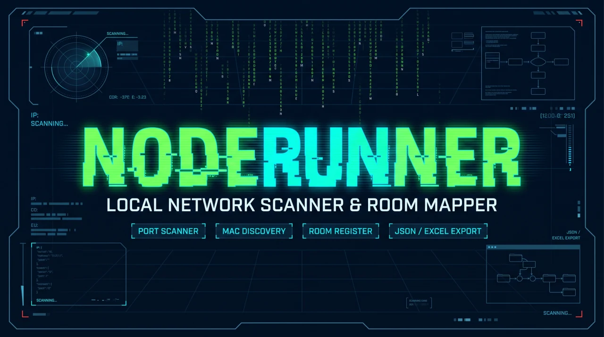

# NodeRunner

[English](README.md) | Italiano

**Versione 0.1.2 · 17 ottobre 2026 · sviluppo**



*Map your network. Know every node.*

Applicazione web locale per scoprire i dispositivi della rete, organizzarli su una mappa e mantenere un registro personalizzato. Il backend Python usa Nmap; l'interfaccia è scritta in HTML, CSS e JavaScript senza framework o compilazione.

**Per riprendere lo sviluppo:** leggere [SESSION_HANDOFF.md](SESSION_HANDOFF.md), poi [PROJECT_STATUS.md](PROJECT_STATUS.md). Le istruzioni per i contributori sono in [AGENTS.md](AGENTS.md).

## Grafica del progetto

Banner, icona NR e wallpaper sono in [assets/branding](assets/branding/README.md). Gli originali sono conservati senza modifiche; l'app carica soltanto le copie ottimizzate. [Scarica il wallpaper originale](assets/branding/originals/wallpaper.jpeg) oppure [la versione WebP](docs/images/noderunner-wallpaper.webp).

La [preview per GitHub](docs/images/noderunner-social-preview.png) è 1280×640 e inferiore a 1 MB. Per attivarla: **Repository Settings → Social preview → Edit → Upload an image**. Inserirla nel repository non imposta automaticamente la preview. Le illustrazioni promozionali non sono screenshot dell'app; nessuno screenshot reale della rete è incluso.

## Versione e novità

La versione **v0.1.2** compare sotto il nome NodeRunner nella barra superiore, sia in Map sia in Registry. Cliccare sul **nome o sull’icona** per aprire il changelog organizzato per data e versione; chiudere con ×, Esc o un clic sullo sfondo. Le stesse note sono disponibili in [CHANGELOG.md](CHANGELOG.md). La prima versione numerata è v0.1.0; v0.1.1 integra le grafiche ufficiali; v0.1.2 aggiunge griglie configurabili, controlli condivisi e un RPM sperimentale Fedora 44.

Il menu **Theme** mostra il tema attuale e le opzioni Light, Phosphor e Ion con anteprime e descrizioni. Il tema selezionato è evidenziato e ricordato nel browser. I contenuti e il menu hanno margini laterali più ampi; su schermi stretti la barra si dispone su più righe.

## Nome e compatibilità

Il progetto ora si chiama **NodeRunner**. Avvio principale: `sudo python3 noderunner.py`; pagina principale: `NodeRunner.html`. Nome, logo vettoriale, favicon, impostazioni, titolo del registro e nomi dei report sono aggiornati. La barra centrale **Map | Registry** permette di cambiare vista; il pulsante attivo è evidenziato. Map usa un sonar, Registry una tabella.

La cartella di sviluppo è `/var/www/html/NodeRunner`, raggiungibile con Apache da `http://localhost/NodeRunner/`. I vecchi file `homenetscanner.py`, `HomeNetScanner.html` e `deploy/apache-homenetscanner.conf` sono collegamenti compatibili ai nuovi file. Dati, backup e token esistenti non devono essere rinominati manualmente. Le nuove preferenze del browser usano `noderunner_*`, con lettura delle precedenti chiavi `hns_*`; l'API accetta anche il precedente header `X-HNS-Token`.

Dopo questo aggiornamento **arrestare il vecchio backend con Ctrl+C**, riavviarlo con `sudo python3 noderunner.py` mantenendo gli eventuali argomenti usati, poi ricaricare il browser con **Ctrl+F5**. Il riavvio avvia una scansione, come in precedenza. Il nuovo frontend richiede il backend aggiornato.

## Avvio rapido

Servono **Python 3.8+** e **Nmap** nel PATH. Non occorrono pacchetti Python aggiuntivi o Scapy. La versione Python minima dichiarata non è stata verificata nella suite attuale: vedere le versioni effettivamente usate nello stato del progetto.

Su Fedora, se mancano le dipendenze:

```bash
sudo dnf install python3 nmap
```

Avviare dal terminale:

```bash
cd /var/www/html/NodeRunner
sudo python3 noderunner.py
```

Aprire **http://localhost:8000**. Da un altro computer della LAN usare l'indirizzo del computer che esegue il backend.

1. Copiare il token stampato nel terminale all'avvio.
2. Aprire **Settings → Connection → Backend token**.
3. Incollare il token e premere **SAVE TOKEN**. Ripetere per ogni browser o dispositivo.
4. Premere **RUN SCAN** per una nuova scansione.

Lasciare aperto il terminale. **Ctrl+C** arresta il servizio; riavviarlo dopo modifiche al codice Python. Senza privilegi elevati la scansione può funzionare, ma MAC e produttori potrebbero mancare. Eseguire scansioni soltanto sulle reti che si è autorizzati a gestire.

## Percorsi di sistema per il futuro RPM Fedora

Il layout di sistema usa `/usr/share/noderunner/` per i file dell'applicazione,
`/usr/bin/noderunner` per il comando e `/var/lib/noderunner/` per registro,
token e backup privati. `/etc/noderunner/noderunner.conf` configura indirizzo e porta del servizio
systemd incluso nell’RPM; l’avvio Python diretto non legge questo file.

Il launcher `deploy/noderunner` seleziona i percorsi di sistema. L'avvio diretto
dal sorgente conserva i percorsi locali esistenti. Sono disponibili `--data-dir`
e `--assets-dir`, oppure le variabili `NODERUNNER_DATA_DIR` e
`NODERUNNER_ASSETS_DIR`; gli argomenti espliciti prevalgono sulle variabili.
La migrazione dei dati è manuale e conserva il token esistente. Vedere
[layout e migrazione](deploy/INSTALL.md).

La versione 0.1.2 include un **RPM sperimentale Fedora 44** e un servizio systemd
con utente dedicato: vedere [installazione e test RPM](deploy/INSTALL.md). Apache è facoltativo: Python serve già l’interfaccia.

## Checkout di sviluppo da GitHub e cambio directory

Il checkout di sviluppo su questo host è `/var/www/html/NodeRunner`. Per una **nuova installazione**, con directory di destinazione non ancora esistente:

```bash
cd /var/www/html
sudo git clone https://github.com/markhawks/NodeRunner.git NodeRunner
cd /var/www/html/NodeRunner
sudo python3 noderunner.py
```

L'installazione esistente è già stata rinominata dall'utente: non clonare sopra questa directory e non rieseguire i vecchi script di migrazione. Per spostare un'altra installazione, arrestare prima il backend, spostare tutta la cartella inclusi dati e file nascosti, aggiornare eventuali percorsi Apache e directory di lavoro dei servizi, quindi riavviare dalla nuova cartella con gli stessi argomenti. Conservare `assignments.json`, backup e nomi dei token esistenti. Nell’avvio diretto dal sorgente, risorse e dati vengono cercati rispetto al file Python salvo opzioni esplicite per i percorsi.

Il backend resta su `http://localhost:8000`; con Apache configurato per servire la directory, la pagina è `http://localhost/NodeRunner/`. Aggiornare i segnalibri e ricaricare con Ctrl+F5. Cambiando hostname o porta può essere necessario reinserire nel browser il token esistente da Settings → Connection.

## Opzioni di avvio

```bash
sudo python3 noderunner.py --target 192.168.1.0/24
sudo python3 noderunner.py --no-ports
sudo python3 noderunner.py --top-ports 100
sudo python3 noderunner.py --port 8080
```

| Opzione | Effetto |
| --- | --- |
| `--target CIDR` | Seleziona una rete IPv4; accetta anche un singolo indirizzo. |
| `--no-ports` | Cerca gli host senza eseguire la scansione delle porte. |
| `--top-ports N` | Prova le N porte TCP più comuni; valore predefinito: 30. |
| `--bind ADDRESS` | Indirizzo IPv4 HTTP; avvio diretto su tutte le interfacce, servizio RPM su localhost. |
| `--port N` | Cambia la porta HTTP; aprire nel browser la stessa porta. |
| `--data-dir PATH` | Directory scrivibile per registro, token e backup. |
| `--assets-dir PATH` | Directory con pagina HTML e `static/`. |
| `--html PATH` | Usa un altro file HTML; le risorse restano nella directory selezionata per gli asset. |

Senza `--target`, viene usata la rete salvata nelle impostazioni; in sua assenza il programma costruisce una rete `/24` dall'IP locale. Questa scelta non rileva la maschera effettiva dell'interfaccia. IPv6 non è supportato per le scansioni.

## Funzioni e limiti

### Mappa e posizioni degli host

In **Settings → Rooms** ogni stanza dispone di un selettore per la griglia minima: **2×2 (4 posti)**, **3×3 (9 posti)** o **4×4 (16 posti)**. Le stanze esistenti mantengono 4×4 come valore predefinito. Larghezza delle stanze, altezza delle righe e superficie scorrevole della mappa si adattano alle griglie selezionate. Se gli host superano i posti scelti, la griglia cresce automaticamente. La griglia è un riferimento per la disposizione iniziale. Trascinare una scheda nel punto desiderato: la posizione esatta viene salvata senza aggancio alle celle o riallineamento dei vicini, anche per gli host senza stanza. Oltre 16 host la griglia aumenta automaticamente, per esempio a 5×5.

La mappa cresce per mantenere leggibili le schede: usare lo scorrimento orizzontale e verticale per raggiungere tutte le stanze. Il pulsante **Expand map**, disponibile nella barra solo in Map, chiude entrambe le liste laterali; **Restore lists** ripristina la precedente combinazione destra/sinistra. Le frecce ai lati della mappa permettono di gestire ogni lista separatamente. Il comando conserva il centro della vista e le posizioni salvate. I pannelli Wi-Fi/Wired occupano colonne separate dalla mappa; aprendo Wired, l’inquadratura mantiene il bordo destro visibile senza spostare gli host. Anche il **gateway/modem** può essere assegnato a una stanza dal campo **Room** nel registro o nei dettagli, e trascinato sulla mappa. Wi-Fi/Wired e il ruolo Gateway restano distinti dall'assegnazione della stanza.

Per applicare questi aggiornamenti frontend è sufficiente **Ctrl+F5**. Verificare nel browser trascinamento, scorrimento e conservazione delle posizioni dopo un ricaricamento.

### Tema chiaro e registro

La barra superiore **Map | Registry | Run scan** resta disponibile nelle due viste. **Run scan** avvia una nuova scansione e mostra **Scanning…** finché termina; impedisce avvii duplicati anche cambiando vista. Accanto sono visibili l’ultima scansione o l’eventuale errore. L’indicatore LIVE è stato rimosso.

Aprire il menu dall’**icona della tavolozza** nella barra superiore e scegliere **Light**, **Phosphor** o **Ion**. Il menu mostra nome, descrizione e anteprima delle opzioni ed è condiviso tra Map e Registry; la scelta viene ricordata nel browser e si applica anche alle impostazioni. I tre vecchi pulsanti tema sono stati rimossi.

Il registro si apre sempre come **pagina a schermo intero**, raggiungibile anche con `http://localhost:8000/#registry`. **Map** nella barra centrale o Esc riportano alla mappa; funziona anche il tasto Indietro del browser. Dalla pagina si possono avviare scansioni e aprire le impostazioni.

La tabella usa caratteri più grandi, righe distanziate e intestazioni fisse durante lo scorrimento. I contatori mostrano host conosciuti, presenti nell'ultima scansione e attendibili. Il filtro **Show** seleziona tutti gli host, quelli presenti/assenti nell'ultima scansione o quelli attendibili; la ricerca comprende anche hostname rilevato e stanza. Le colonne rimangono modificabili e, sugli schermi piccoli, si possono scorrere orizzontalmente.

Per ordinare, cliccare direttamente sul **nome della colonna**: **Vendor** per produttore, **Room** per stanza, oppure un'altra intestazione. Un secondo clic inverte l'ordine; la freccia indica crescente o decrescente. La colonna Actions non è ordinabile. IP e date sono confrontati numericamente, le stanze per nome e i vendor usando la scelta manuale se presente, altrimenti il produttore rilevato. I campi vuoti restano in fondo in entrambe le direzioni. L'export Excel mantiene l'ordinamento della tabella.

Ordinando per **Room**, il registro si divide in tabelle distinte per stanza, con una sezione **Unassigned room** per gli host senza stanza. Ordinando per **Connection**, compaiono tabelle per **Wi-Fi**, **Wired**, **Gateway** e **Unassigned connection**. Ogni gruppo mostra il proprio conteggio e le stesse colonne modificabili. Ricerca e filtri si applicano prima del raggruppamento; non vengono mostrate tabelle vuote. Un secondo clic inverte l'ordine dei gruppi; scegliere un'altra colonna ripristina la tabella unica. L'export Excel resta su un unico foglio, seguendo l'ordine delle tabelle e delle righe visualizzate.

La colonna **Connection**, subito dopo **Scan status**, permette di scegliere **Wi-Fi**, **Wired** o **Unassigned**. La colonna **Vendor** offre lo stesso menu della scheda del dispositivo: produttori comuni, vendor aggiunti nelle impostazioni, opzione automatica e **Other (type it in)** per un nome libero. Queste modifiche si riflettono sulla mappa e nell'export Excel. La connessione è assegnata manualmente, non rilevata da Nmap.

Anche il **gateway** compare nel registro e nei report Excel, con IP, MAC, vendor e tipo **Router / Gateway**. La connessione mostra il ruolo **Gateway**, come sulla mappa. Il nome predefinito visualizzato è **Gateway Router**; si può personalizzare nel registro o nella scheda del dispositivo. L'hostname riportato dalla scansione resta visibile come **Detected** nel registro e **Detected hostname** nei dettagli. Nmap esegue normalmente la [risoluzione DNS inversa](https://nmap.org/book/host-discovery-dns.html): nomi simili a un indirizzo web sono dati del rilevamento, non pagine aperte dall'app. Un gateway soltanto dedotto mantiene lo stato **Not verified** e non aggiorna l'orario di ultimo avvistamento.

**Seen in scan** indica presenza nell'ultima scansione riuscita, non una verifica continua. **Not in scan** non prova che un dispositivo sia spento. Quando i risultati non sono disponibili compare **Not verified**. Per chiudere il registro si può premere Esc.

Le righe **Not in scan** sono evidenziate in giallo tenue, con badge giallo e un bordo laterale, anche per gli host attendibili. L'evidenziazione funziona nei temi chiaro e scuri e nelle tabelle raggruppate; **Not verified** mantiene la colorazione neutra.

### Esportazione Excel

Nel registro premere **Export Excel (.xlsx)**: scarica i dispositivi visualizzati, rispettando ricerca, filtro e ordinamento. Per esportare tutti gli host, scegliere **All devices** e svuotare la ricerca.

Il foglio include fiducia, stato della scansione, alias, hostname, IP, MAC, produttore, tipo, stanza, connessione, porte, ultimo avvistamento in UTC e flag. La prima riga è bloccata e le colonne hanno filtri Excel. I valori sono testo, comprese le stringhe che iniziano con `=`: non vengono esportate formule o collegamenti esterni.

Il file Excel è un report; per ripristinare personalizzazioni usare **Export JSON / Import JSON**. Il token non compare nel report. L'export richiede il backend aggiornato e non avvia scansioni né salva modifiche al registro. Dopo l'aggiornamento riavviare Python e ricaricare la pagina con Ctrl+F5.

### Rilevamento e gestione

- Rileva IP, MAC, hostname, produttore e porte TCP aperte tra quelle provate.
- Stima la categoria del dispositivo; nomi, categorie, produttori e stanze possono essere corretti manualmente.
- Mostra una mappa con trascinamento e un registro degli host conosciuti, con importazione/esportazione JSON.
- Segnala nuovi host, scomparse, cambiamenti di IP e host contrassegnati come bloccati ma ancora presenti.
- Wi-Fi/cavo e stanze sono assegnazioni manuali. La mappa non ricostruisce i collegamenti fisici della rete.
- **MARK BLOCKED è un'etichetta del registro:** non modifica router o firewall.
- L'aggiornamento automatico è disabilitato (`AUTO_REFRESH_MS = 0`). I risultati restano in memoria fino a una nuova scansione o al riavvio.
- Un hostname uguale suggerisce una possibile corrispondenza; non trasferisce automaticamente identità o fiducia a un nuovo MAC.

## File e dati

```text
noderunner.py                Backend, Nmap, API e persistenza
NodeRunner.html             Pagina principale; index.html è un collegamento
static/app.js                Stato, validazione, mappa, avvisi e salvataggi
static/icons.js              Catalogo e sanificazione delle icone SVG
static/registry.js           Registro e importazione/esportazione
static/settings.js           Impostazioni e token del browser
static/style.css             Aspetto dell'interfaccia
static/noderunner*.svg       Logo, favicon e icona delle schede fissate
static/manifest.webmanifest  Nome e icona dell'applicazione
tests/                       Test Python e JavaScript senza dipendenze aggiuntive
deploy/                      Configurazione Apache da installare separatamente
docs/SECURITY_REVIEW.md       Correzioni e limiti della verifica di sicurezza
```

`assignments.json` conserva personalizzazioni, host conosciuti e configurazione. `noderunner_token.txt` conserva il segreto di accesso alle API; nelle installazioni precedenti continua a essere usato `hns_token.txt`, senza rigenerarlo. Entrambi sono dati locali esclusi da Git; non condividerli insieme ai sorgenti. Il browser conserva il proprio token, il tema e una copia locale dello stato.

All'avvio viene creato al massimo un backup giornaliero `assignments.json.bak.AAAA-MM-GG`, mantenendo i cinque più recenti. Per un backup trasferibile usare l'esportazione del registro. Prima di ripristinare manualmente un file, arrestare il backend e conservare una copia del registro corrente. Il token non è incluso nell'esportazione del registro.

## Verifiche di sviluppo

Node.js serve soltanto per i controlli JavaScript; non è necessario per usare il software.

```bash
python3 -m unittest discover -s tests -p 'test_*.py' -v
node tests/test_frontend.js
node --check static/app.js
node --check static/icons.js
node --check static/registry.js
node --check static/settings.js
```

La suite attuale comprende **41 test Python e 64 controlli JavaScript**. Usa file temporanei, risultati Nmap simulati e richieste HTTP elaborate in memoria. Non apre porte né esegue scansioni. Legge il registro locale, se presente, per verificarne la compatibilità senza modificarlo. Non sostituisce una prova in un browser reale.

## API

Tutte le richieste `/api/*` richiedono l'header **`X-NodeRunner-Token`**.

| Metodo e percorso | Funzione |
| --- | --- |
| `GET /api/devices` | Ultima scansione in cache; ne avvia una se la cache è vuota. |
| `GET /api/scan` | Forza una nuova scansione. |
| `GET/POST /api/assignments` | Legge o salva registro e personalizzazioni. |
| `GET/POST /api/config` | Legge o cambia la rete da scansionare. |
| `POST /api/export.xlsx` | Genera un file Excel dalle righe visualizzate inviate dal browser; richiede token. |

Un errore di Nmap restituisce HTTP 502. Un corpo JSON non valido viene rifiutato; il limite delle richieste è 2 MiB. Un registro corrotto non viene sostituito silenziosamente con uno vuoto.

L'export accetta `{"rows": [["…", "…"]]}` con 14 celle di testo per riga, al massimo 10.000 righe, entro il limite HTTP di 2 MiB. Genera il file in memoria con la libreria standard Python, senza dipendenze aggiuntive.

## Apache e accesso dalla rete

Il backend serve già l'interfaccia e ascolta su **tutte le interfacce IPv4**, non soltanto su localhost. Usa HTTP senza cifratura: per accessi oltre una LAN fidata occorre predisporre un accesso protetto e TLS.

Se Apache serve questa directory, proteggere anche i file interni. Nell'installazione esaminata `AllowOverride None` rende inefficace un semplice `.htaccess`. Il file preparato **non è ancora installato**:

```bash
sudo install -m 644 deploy/apache-noderunner.conf /etc/httpd/conf.d/noderunner.conf
sudo apachectl configtest && sudo systemctl reload httpd
```

La configurazione contiene il percorso `/var/www/html/NodeRunner`: adattarlo per altre installazioni. Con Nginx o altri server servono regole equivalenti. I file privati devono restare non accessibili via HTTP anche quando il backend Python è spento.

Le pagine servite dal backend usano la propria origine, comprese porte personalizzate e reverse proxy. Una pagina servita direttamente da Apache cerca invece le API sulla porta 8000 dello stesso host; una pagina aperta con `file://` usa `http://localhost:8000`.

## Problemi frequenti

| Sintomo | Controllo |
| --- | --- |
| `nmap not found` | Installare Nmap e controllare `nmap --version`. |
| Token mancante o HTTP 403 | Inserire il token del backend corretto in Settings → Connection. |
| Connessione non riuscita | Controllare terminale, indirizzo, porta e accesso al server dalla LAN. |
| MAC/produttore assenti | Verificare privilegi e raggiungibilità dei dispositivi sul segmento locale. |
| HTTP 502 | Leggere il messaggio di errore della scansione e verificare target e Nmap. |
| Errore di salvataggio | Verificare permessi, token e integrità di `assignments.json`; non cancellarlo per risolvere l'errore. |

`support.js` è un bundle esterno non caricato dall'applicazione e non fa parte del percorso di scansione.

## License

SPDX-License-Identifier: AGPL-3.0-only

Copyright (C) 2026 NodeRunner contributors.

NodeRunner is licensed under the GNU Affero General Public License, version 3 only. See [LICENSE](LICENSE). Distributed derivative works must retain the applicable copyleft terms; modified versions offered over a network must make their corresponding source available as required by the license. Commercial use and redistribution are permitted. This software comes without warranty.

Source repository: [markhawks/NodeRunner](https://github.com/markhawks/NodeRunner).
